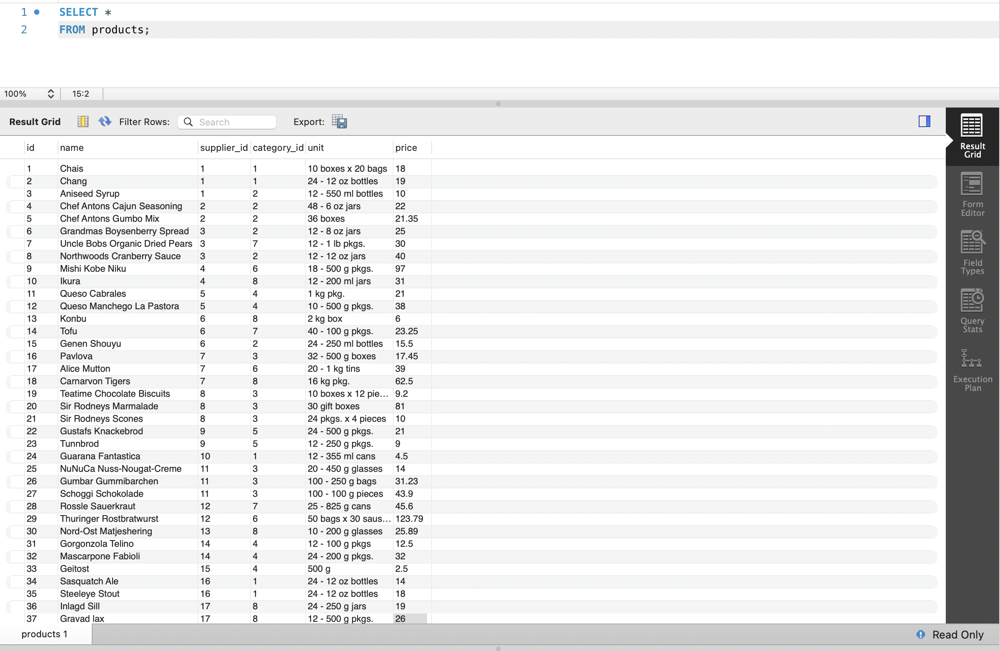
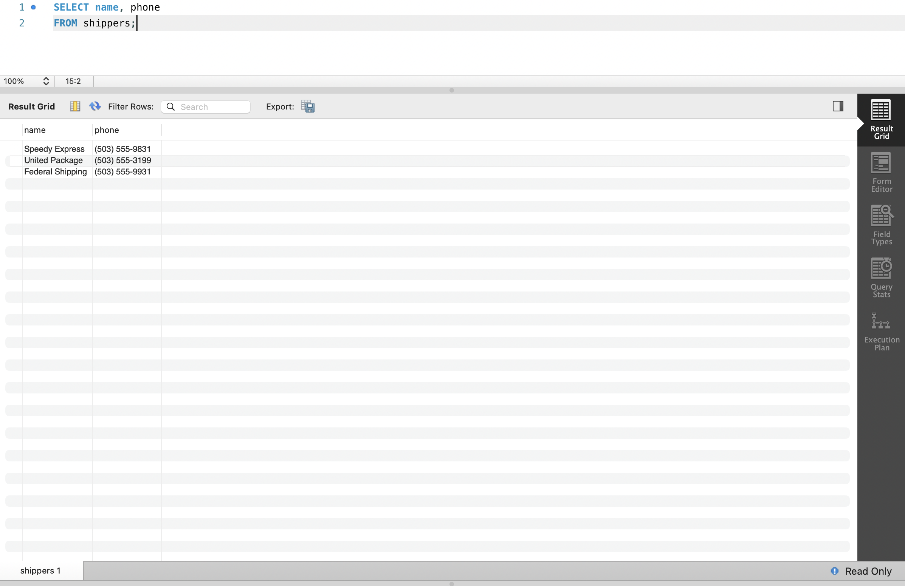
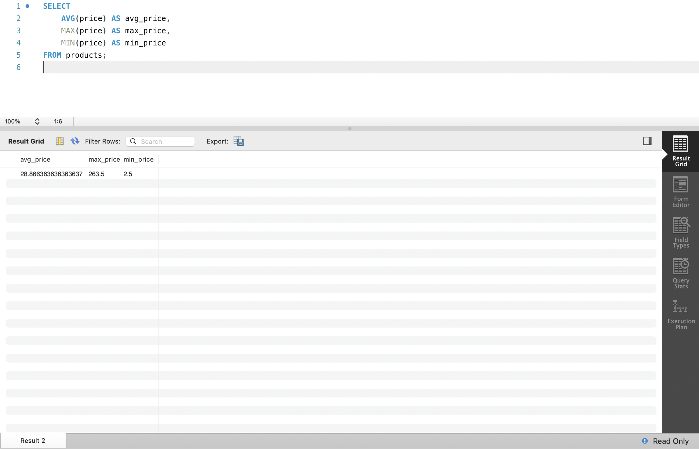
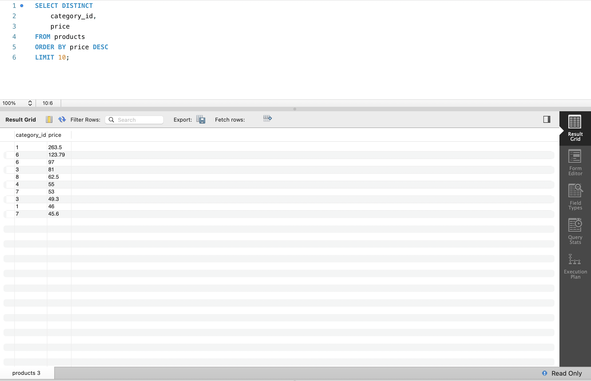
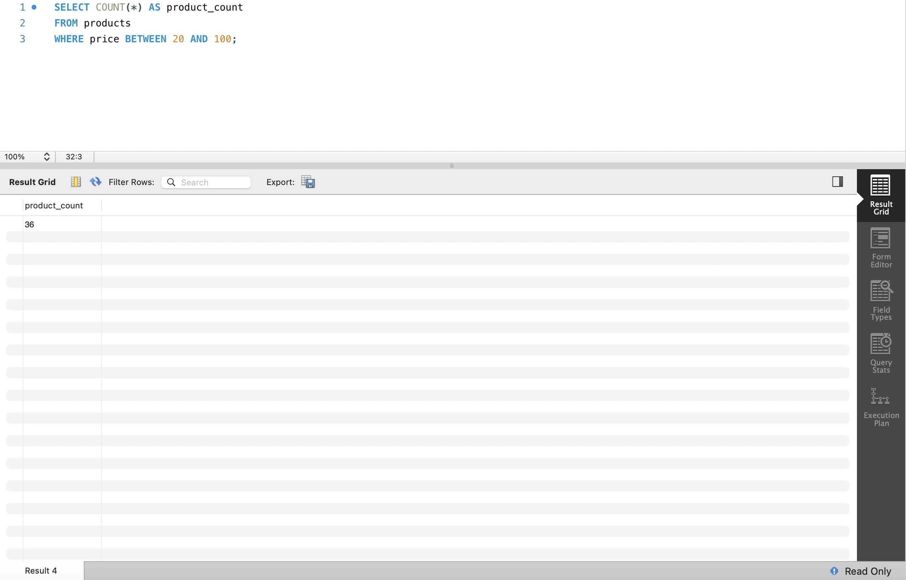
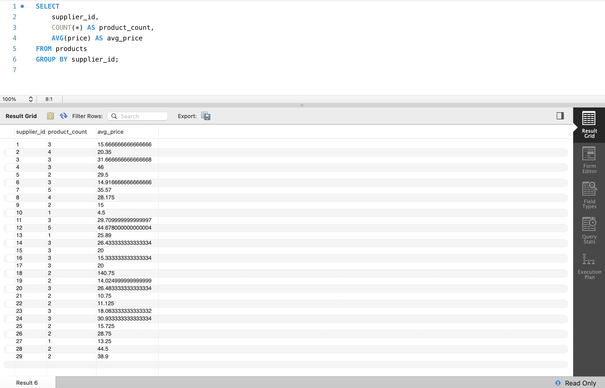

# DQL команди (Data Query Language)

### 1.1. Вибрати всі стовпчики з таблиці `products`

```sql
SELECT * 
FROM products;
```



---

### 1.2. Вибрати тільки стовпчики `name`, `phone` з таблиці `shippers`

```sql
SELECT name, phone 
FROM shippers;
```



---

### 2. Середнє, максимальне та мінімальне значення стовпчика `price` в `products`

```sql
SELECT 
    AVG(price) AS avg_price,
    MAX(price) AS max_price,
    MIN(price) AS min_price
FROM products;
```



---

### 3. Унікальні комбінації `category_id` та `price` (сортування за спаданням ціни, топ-10)

```sql
SELECT DISTINCT 
    category_id, 
    price
FROM products
ORDER BY price DESC
LIMIT 10;
```



---

### 4. Кількість продуктів у ціновому діапазоні від 20 до 100

```sql
SELECT COUNT(*) AS product_count
FROM products
WHERE price BETWEEN 20 AND 100;
```



---

### 5. Кількість продуктів та середня ціна у кожного постачальника (`supplier_id`)

```sql
SELECT 
    supplier_id,
    COUNT(*) AS product_count,
    AVG(price) AS avg_price
FROM products
GROUP BY supplier_id;
```


